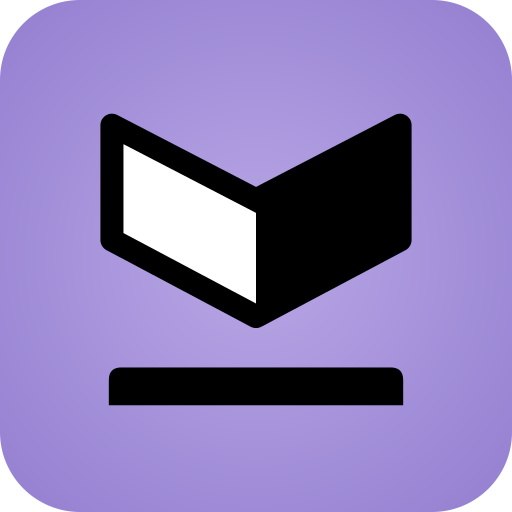
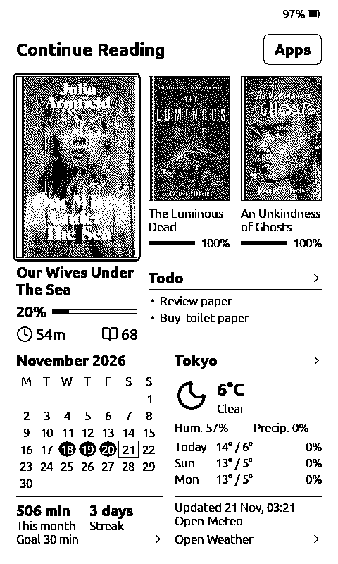
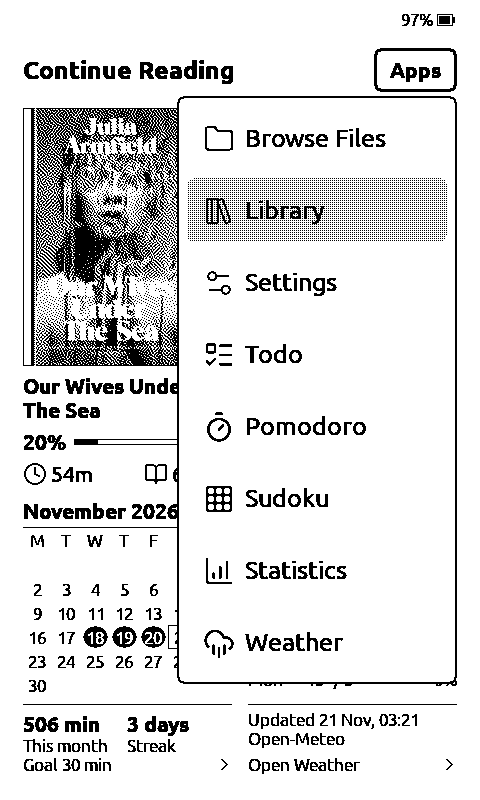
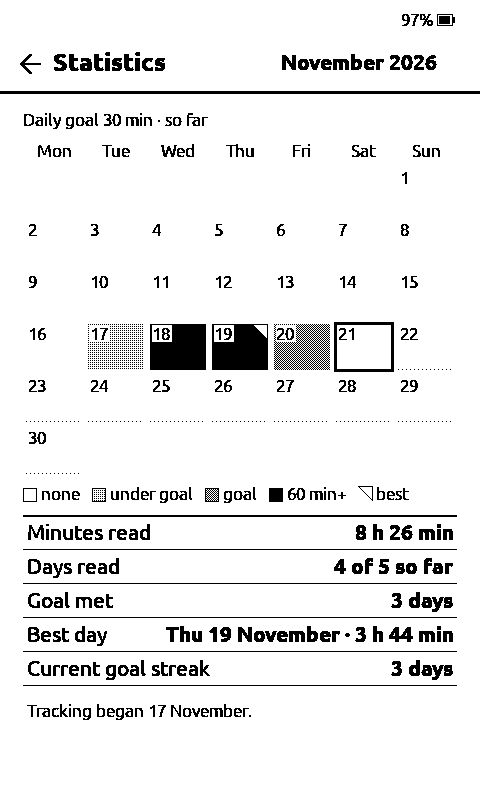
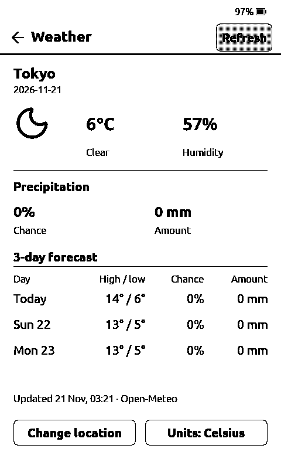
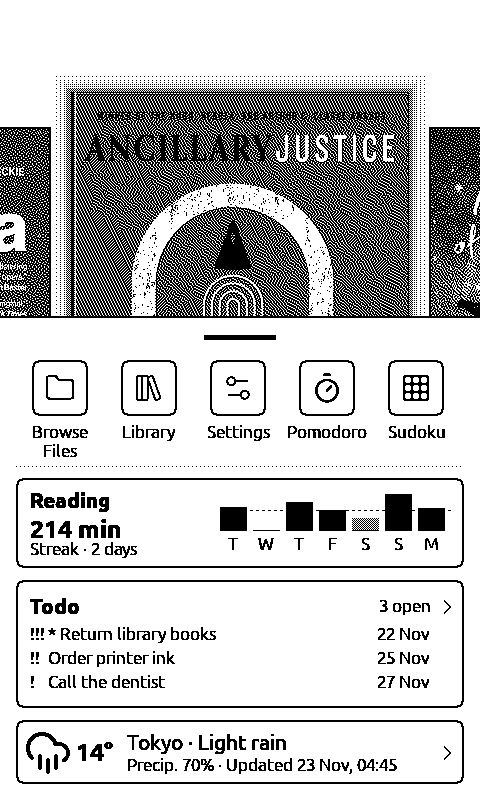
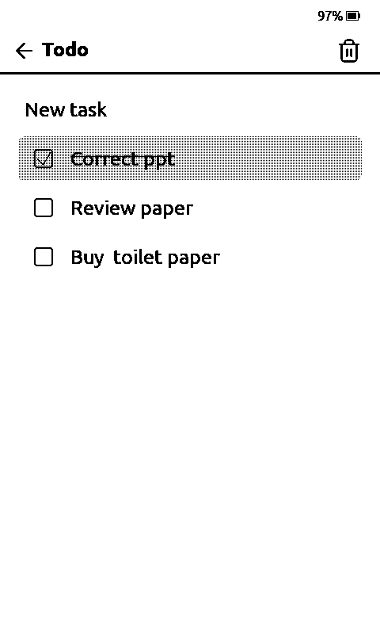
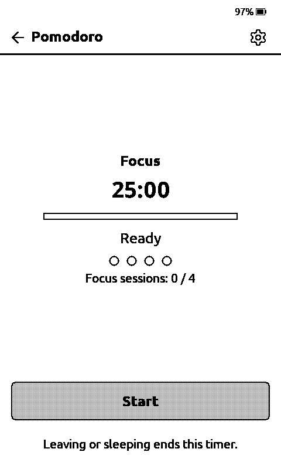
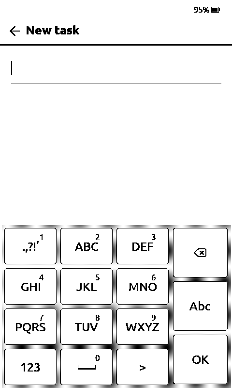

<p align="center"></p>

# CrossDesk Reader

CrossDesk Reader is firmware for the BOOX Picco, based on
[CrossPoint Reader](https://github.com/crosspoint-reader/crosspoint-reader).
It is an unofficial fork, not supported by the CrossPoint project or BOOX.

The fork follows upstream CrossPoint closely, so treat it like a development
branch: new upstream changes arrive often, and bugs can still appear.

## What's new in 0.3.0

Coverflow adds a cover-first Home screen and an apps sheet with Reading, Todo
and Weather cards. Todo adds a task editor, priorities, due dates and four ways
to sort open tasks. [0.3.0 release notes](docs/releases/0.3.0.md)

## Desk

Desk is the Home screen theme that gives CrossDesk Reader its name.
It shows the current book's cover large, with its title, progress,
reading time and pages turned, and the other recent books as a swipeable strip
of small covers with their titles and progress bars. Its other apps (Browse
Files, Library, Settings, Todo, Pomodoro, Sudoku, Statistics, Weather and any
Plugins or OPDS shortcut) open from **Apps** at the top right of Home.

<p align="center">
  
  
</p>

Desk also shows:

- A Todo preview in the chosen sort order, with priority and overdue marks.
  Tap it to open Todo; its bullets do not complete tasks.
- A [reading calendar](docs/reading-calendar.md) with monthly minutes, a streak
  of days meeting your daily reading goal and the goal itself. Tap the day grid
  to open **Statistics**, or tap the totals/goal footer to change the goal in
  Settings.
- A [weather widget](docs/weather.md) with a manually refreshed three-day
  forecast, humidity and precipitation for a city you choose. Tap it to open
  Weather.

When there is no data, each widget says why instead of disappearing.
Desk needs PSRAM, which the Picco has. You can choose another theme in Settings.

The calendar opens monthly Statistics, and the weather widget opens Weather:

<p align="center">
  
  
</p>

## Coverflow

Coverflow needs touch and PSRAM, both available on the Picco.
Choose **Settings > Display > UI Theme > Coverflow**. Swipe
left or right, press Up or Down, or tap a side cover to move between recent
books. Tap the centre cover to open the book.

Swipe up or tap the arrow to open the apps sheet. Its Reading, Todo and Weather
cards open Statistics, Todo and Weather. To close the sheet, swipe down, tap
above it or press Back. Back does nothing on Coverflow Home when the sheet is
closed.

**Coverflow Progress** is on by default. The line below the centre cover can
show saved progress and recorded reading time.
You can turn it off in **Settings > Display** while using Coverflow.

<p align="center">
  
  
</p>

## Todo

Todo keeps up to 32 tasks offline. Tap a task to edit its text and due date.
Cycle its priority from the list, or sort open tasks by priority, due date,
creation date or added order. Desk and Coverflow preview the open tasks in the
same order. [Todo guide](docs/picco-todo.md)

<p align="center">
  
</p>

## Other features added by this fork

- [Pomodoro](docs/picco-pomodoro.md): a foreground focus/break timer.
- [Sudoku](docs/picco-sudoku.md): notes, undo, hints, saved games and puzzle-pack downloads.
- [T9 keypad](USER_GUIDE.md#36-settings): a phone-style keypad for every text field, as an option to the
  full keyboard. Tap a key again to cycle its letters. Choose it in Settings >
  System > Keyboard type, and set its size with Keypad height.
- [Reading statistics](docs/picco-reading-stats.md): Book statistics for EPUB,
  TXT, Markdown and XTC/XTCH books (progress, reading time, forward page turns, and a
  confirmed reset that keeps position and bookmarks). It is in the reader menu,
  or at the top of the XTC chapter list. Library shows each opened EPUB, TXT or
  Markdown book's saved percentage. Home can show the current book's progress
  and reading time.
- Monthly **Statistics**: a read-only page with one month of the reading
  calendar. Open it from Desk, the Coverflow Reading card or the other themes'
  Home menus. In Cover Grid, use the chart icon.
- File Transfer from the Files root header.
- `My Clippings.txt` is hidden from Library and Home, but stays in Files.

<p align="center">
  
  
  
</p>

## From CrossPoint Reader

EPUB reading, Library, the Classic, Lyra, Lyra Extended, RoundedRaff and Cover
Grid themes, custom and SD-card fonts, bookmarks, dictionary lookup, clippings,
web file transfer, OPDS, plugins and the other reader features come from
upstream CrossPoint. Support for other boards is kept.

## Try the simulator

Keep the firmware and simulator repositories side by side:

```sh
git clone --recurse-submodules -b picco https://github.com/DumbledoreCalrissian/crossdesk-reader.git
git clone -b main https://github.com/DumbledoreCalrissian/crosspoint-simulator.git
cd crossdesk-reader
pio run -e simulator_picco
pio run -e simulator_picco -t run_simulator
```

See [setup instructions](docs/contributing/getting-started.md) for the macOS
requirements. Put books in `fs_/books/`; set `CROSSPOINT_SIM_SD` to use another
virtual card directory. Build native Picco firmware with `pio run -e picco`.
`pio run -e picco -t upload` writes only the app partition and keeps the stock
bootloader and recovery partition. Back up the full flash before your first
upload; recovery has not been tested.

## Releases

Releases are tagged `crossdesk-v<version>`, for example `crossdesk-v0.3.0`,
so they never clash with upstream CrossPoint's version tags. Each release has
one file per board, named `crossdesk-<version>-<board>.bin` (for the Picco,
`crossdesk-<version>-picco.bin`). The firmware's update check uses these names.
Install the downloaded Picco file over USB.
[Picco installation instructions](docs/releases/0.3.0.md#installing-on-the-picco)

## Help

- [Reader user guide](USER_GUIDE.md)
- [Web file transfer](docs/webserver.md)
- [SD-card fonts](docs/sd-card-fonts.md)

Back up your card before experimenting. `/.crosspoint/` contains saved tasks,
puzzles, settings and reading positions; do not delete it as a general reset.

## Credits and licences

Based on CrossPoint Reader and [FreeInk SDK](https://github.com/Free-Ink/freeink-sdk),
with the [CrossPoint simulator](https://github.com/crosspoint-reader/crosspoint-simulator).
Sudoku puzzles come from the public-domain
[Sudoku Exchange puzzle bank](https://github.com/grantm/sudoku-exchange-puzzle-bank).
Original copyright and third-party notices are retained.

See [LICENSE](LICENSE) and [third-party licences and source information](licenses/README.md).
The combined firmware executable uses GPLv3 because it includes wolfSSL.
